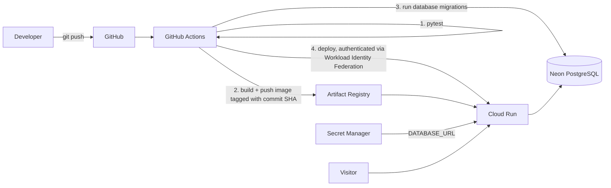
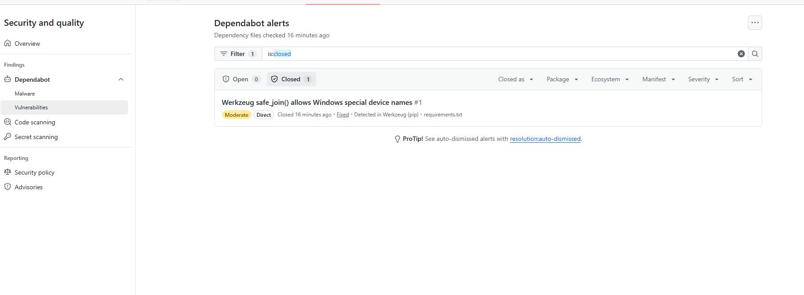

# ShopHub

A small e-commerce API built to demonstrate a complete cloud delivery workflow: containerised app, infrastructure as code, automated tests, automated security scanning and a keyless CI/CD pipeline, running on Google Cloud at near-zero cost.

**Live:** https://shophub-i7hqueeccq-uc.a.run.app
- `/health` health check
- `/api/products` product list
- `/api/products/<id>` single product

## Architecture



## Stack

| Layer | Choice |
|---|---|
| App | Python, Flask, SQLAlchemy, Flask-Migrate, gunicorn |
| Database | PostgreSQL on Neon (free tier) |
| Container | Docker, Artifact Registry |
| Hosting | Google Cloud Run (scales to zero) |
| Infrastructure as code | Terraform (separate repo: shophub-infra) |
| CI/CD | GitHub Actions with Workload Identity Federation |
| Secrets | Google Secret Manager |
| Security scanning | pip-audit, Bandit, CodeQL, Dependabot, GitHub secret scanning |

## How it works

1. Every push to `main` runs the test suite.
2. If tests pass, the image is built, tagged with the commit SHA and pushed to Artifact Registry.
3. Database migrations run (`flask db upgrade`) against the production database before the new code goes live.
4. Cloud Run is updated to that exact image, then a smoke test calls `/health`.
5. Pull requests run tests only and never deploy or migrate.

## Decisions and trade-offs

- **Cloud Run instead of GKE.** The app is small and stateless. Cloud Run scales to zero, so an idle portfolio project costs nothing. GKE would add a cluster fee and always-on nodes.
- **Neon instead of Cloud SQL.** Cloud SQL bills hourly even when idle. Neon's free tier keeps the data layer free, and it is still real PostgreSQL.
- **No stored cloud keys.** GitHub authenticates to Google Cloud with short-lived tokens through Workload Identity Federation. The trust rule only accepts this repository on the `main` branch.
- **Least privilege.** The deploy account can push to one registry, update one service and read one secret (the database URL, so it can run migrations). The runtime account can read one secret.
- **Migrations before deploy.** The schema is updated before the new revision starts, so new code never meets an old schema. Migrations must stay backward compatible, because the previous revision keeps serving while they run. Only one deploy runs at a time, so two migrations cannot overlap. A Cloud Run Job running migrations inside Google Cloud would avoid exposing the database URL to the pipeline, and is a possible next step.
- **Immutable image tags.** Each deploy uses the commit SHA, so every release is traceable and rollback is one command.
- **Read-only public API.** There are no public write endpoints, so a public portfolio site cannot be filled with junk data. Sample products are added with a CLI command.
- **Cost controls.** Max 2 instances, 512Mi memory, and a registry cleanup policy that keeps only the 2 newest images, so storage stays inside the free allowance.

## Security

Security checks run on every push, on every pull request and once a week.

| Check | What it covers |
|---|---|
| pip-audit | Known vulnerabilities in the Python packages in `requirements.txt` |
| Bandit | Risky patterns in the application code |
| CodeQL | Deeper static analysis, with results in the repository's Security tab |
| Dependabot | Pull requests for outdated packages, GitHub Actions and Docker base images |
| Secret scanning and push protection | Blocks passwords and keys from being pushed |

The workflows run with read-only repository permissions (`contents: read`).

The first scan found a vulnerable Werkzeug version (CVE-2026-102598). I fixed it by upgrading to 3.1.9, and the alert closed automatically.

Bandit also flagged `app.run(host="0.0.0.0")`. That is intentional: inside a container the app must listen on all interfaces, and production runs under gunicorn. I skip that single rule (B104) in the workflow rather than turning Bandit off.




## Run locally

```bash
python -m venv venv
source venv/bin/activate        # Windows: .\venv\Scripts\Activate.ps1
pip install -r requirements.txt
flask --app app db upgrade
flask --app app seed
flask --app app run --port 8080
pytest
```

Without `DATABASE_URL` the app uses a local SQLite file. Set `DATABASE_URL` to a PostgreSQL connection string to use Postgres.

## Infrastructure

Terraform code for the registry, secret, service accounts, Cloud Run service and CI/CD trust lives in the companion repo: https://github.com/NyashaTendai/shophub-infra

## Performance

First request after idle: 8.9 s with scale-to-zero, 0.85 s with one minimum instance (about $10 a month). Measured with curl from Harare against the live service.
